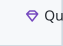
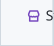

<a href="https://git.io/typing-svg">
 <picture>
  <source media="(prefers-color-scheme: dark)" srcset="https://readme-typing-svg.demolab.com?font=Fira+Code&weight=500&size=36&letterSpacing=-0.5px&duration=2400&pause=900&color=84CC16&background=00000000&center=true&vCenter=true&repeat=true&width=768&height=80&lines=I'm+Nikita+Reshetnik;Backend+%26+AI+systems+engineer;.NET+%C2%B7+Azure+%C2%B7+AI+across+the+stack">
  
 </picture>
</a>

 
<a href="https://www.linkedin.com/in/nikitareshetnik/"><picture><source media="(prefers-color-scheme: dark)" srcset="./assets/hero/linkedin.svg#dark"></picture></a><a href="mailto:reshetnik.nikita@gmail.com"><picture><source media="(prefers-color-scheme: dark)" srcset="./assets/hero/gmail.svg#dark"></picture></a><a href="https://t.me/reshetnigram"><picture><source media="(prefers-color-scheme: dark)" srcset="./assets/hero/telegram.svg#dark"></picture></a><a href="https://leetcode.com/u/grafanaKibana/"><picture><source media="(prefers-color-scheme: dark)" srcset="./assets/hero/leetcode.svg#dark"></picture></a><a href="https://github.com/grafanaKibana/grafanaKibana/issues/new"><picture><source media="(prefers-color-scheme: dark)" srcset="./assets/hero/github.svg#dark"></picture></a>

---

I work on AI systems, backend engineering, and observability-heavy platforms.

- Building agentic and RAG workflows and LLM-powered developer tools
- Designing backend systems with .NET, Azure, and SQL
- Exploring Microsoft Agent Framework, Semantic Kernel, Microsoft.Extensions.AI and LLM evaluation

## Featured

<a href="https://reshetnik.dev#gh-light-mode-only"><picture><source
  media="(min-width: 960px)" srcset="./assets/featured/portfolio-light.jpg" width="49%"></picture></a><a href="https://reshetnik.dev#gh-dark-mode-only"><picture><source
  media="(min-width: 960px)" srcset="./assets/featured/portfolio-dark.jpg" width="49%"></picture></a><picture><source
  media="(min-width: 960px)" srcset="./assets/featured/empty.svg" width="1%" height="1"></picture><a href="https://devbook.zip#gh-light-mode-only"><picture><source
  media="(min-width: 960px)" srcset="https://raw.githubusercontent.com/grafanaKibana/devbook.zip/HEAD/docs/assets/product-captures/hero.png" width="49%"></picture></a><a href="https://devbook.zip#gh-dark-mode-only"><picture><source
  media="(min-width: 960px)" srcset="https://raw.githubusercontent.com/grafanaKibana/devbook.zip/HEAD/docs/assets/product-captures/hero-dark.png" width="49%"></picture></a><a href="https://reshetnik.dev#gh-light-mode-only"><picture><source
  media="(min-width: 960px)" srcset="./assets/featured/portfolio-card.svg" width="49%" height="108"></picture></a><a href="https://reshetnik.dev#gh-dark-mode-only"><picture><source
  media="(min-width: 960px)" srcset="./assets/featured/portfolio-card.svg#dark" width="49%" height="108"></picture></a><picture><source
  media="(min-width: 960px)" srcset="./assets/featured/empty.svg" width="1%" height="1"></picture><a href="https://devbook.zip#gh-light-mode-only"><picture><source
  media="(min-width: 960px)" srcset="./assets/featured/devbook-card.svg" width="49%" height="108"></picture></a><a href="https://devbook.zip#gh-dark-mode-only"><picture><source
  media="(min-width: 960px)" srcset="./assets/featured/devbook-card.svg#dark" width="49%" height="108"></picture></a><a href="https://reshetnik.dev#gh-light-mode-only"><picture><source
  media="(min-width: 960px)" srcset="./assets/featured/portfolio-outline.svg" width="49%" height="46"></picture></a><a href="https://reshetnik.dev#gh-dark-mode-only"><picture><source
  media="(min-width: 960px)" srcset="./assets/featured/portfolio-outline.svg#dark" width="49%" height="46"></picture></a><picture><source
  media="(min-width: 960px)" srcset="./assets/featured/empty.svg" width="1%" height="1"></picture><a href="https://devbook.zip#gh-light-mode-only"><picture><source
  media="(min-width: 960px)" srcset="./assets/featured/empty.svg" width="0" height="0"></picture></a><a href="https://devbook.zip#gh-dark-mode-only"><picture><source
  media="(min-width: 960px)" srcset="./assets/featured/empty.svg" width="0" height="0"></picture></a><a href="https://devbook.zip#gh-light-mode-only"><picture><source
  media="(min-width: 960px)" srcset="./assets/featured/empty.svg" width="0" height="0"></picture></a><a href="https://devbook.zip#gh-dark-mode-only"><picture><source
  media="(min-width: 960px)" srcset="./assets/featured/empty.svg" width="0" height="0"></picture></a><a href="https://devbook.zip#gh-light-mode-only"><picture><source
  media="(min-width: 960px)" srcset="./assets/featured/devbook-outline.svg" width="49%" height="46"></picture></a><a href="https://devbook.zip#gh-dark-mode-only"><picture><source
  media="(min-width: 960px)" srcset="./assets/featured/devbook-outline.svg#dark" width="49%" height="46"></picture></a>

<a href="https://obsidian.md/plugins?id=tabsdown#gh-light-mode-only"><picture><source
  media="(min-width: 960px)" srcset="https://raw.githubusercontent.com/grafanaKibana/obsidian-tabsdown/HEAD/docs/assets/product-captures/hero.png" width="49%"></picture></a><a href="https://obsidian.md/plugins?id=tabsdown#gh-dark-mode-only"><picture><source
  media="(min-width: 960px)" srcset="https://raw.githubusercontent.com/grafanaKibana/obsidian-tabsdown/HEAD/docs/assets/product-captures/hero-dark.png" width="49%"></picture></a><picture><source
  media="(min-width: 960px)" srcset="./assets/featured/empty.svg" width="1%" height="1"></picture><a href="https://obsidian.md/plugins?id=colsdown#gh-light-mode-only"><picture><source
  media="(min-width: 960px)" srcset="https://raw.githubusercontent.com/grafanaKibana/obsidian-colsdown/HEAD/docs/assets/product-captures/hero.png" width="49%"></picture></a><a href="https://obsidian.md/plugins?id=colsdown#gh-dark-mode-only"><picture><source
  media="(min-width: 960px)" srcset="https://raw.githubusercontent.com/grafanaKibana/obsidian-colsdown/HEAD/docs/assets/product-captures/hero-dark.png" width="49%"></picture></a><a href="https://obsidian.md/plugins?id=tabsdown#gh-light-mode-only"><picture><source
  media="(min-width: 960px)" srcset="./assets/featured/tabsdown-card.svg" width="49%" height="108"></picture></a><a href="https://obsidian.md/plugins?id=tabsdown#gh-dark-mode-only"><picture><source
  media="(min-width: 960px)" srcset="./assets/featured/tabsdown-card.svg#dark" width="49%" height="108"></picture></a><picture><source
  media="(min-width: 960px)" srcset="./assets/featured/empty.svg" width="1%" height="1"></picture><a href="https://obsidian.md/plugins?id=colsdown#gh-light-mode-only"><picture><source
  media="(min-width: 960px)" srcset="./assets/featured/colsdown-card.svg" width="49%" height="108"></picture></a><a href="https://obsidian.md/plugins?id=colsdown#gh-dark-mode-only"><picture><source
  media="(min-width: 960px)" srcset="./assets/featured/colsdown-card.svg#dark" width="49%" height="108"></picture></a><a href="https://obsidian.md/plugins?id=tabsdown#gh-light-mode-only"><picture><source
  media="(min-width: 960px)" srcset="./assets/featured/store-outline.svg#first" width="24.5%" height="46"></picture></a><a href="https://obsidian.md/plugins?id=tabsdown#gh-dark-mode-only"><picture><source
  media="(min-width: 960px)" srcset="./assets/featured/store-outline.svg#first-dark" width="24.5%" height="46"></picture></a><a href="https://github.com/grafanaKibana/quartz-tabsdown#gh-light-mode-only"><picture><source
  media="(min-width: 960px)" srcset="./assets/featured/quartz-outline.svg" width="24.5%" height="46"></picture></a><a href="https://github.com/grafanaKibana/quartz-tabsdown#gh-dark-mode-only"><picture><source
  media="(min-width: 960px)" srcset="./assets/featured/quartz-outline.svg#dark" width="24.5%" height="46"></picture></a><picture><source
  media="(min-width: 960px)" srcset="./assets/featured/empty.svg" width="1%" height="1"></picture><a href="https://obsidian.md/plugins?id=colsdown#gh-light-mode-only"><picture><source
  media="(min-width: 960px)" srcset="./assets/featured/empty.svg" width="0" height="0"></picture></a><a href="https://obsidian.md/plugins?id=colsdown#gh-dark-mode-only"><picture><source
  media="(min-width: 960px)" srcset="./assets/featured/empty.svg" width="0" height="0"></picture></a><a href="https://obsidian.md/plugins?id=colsdown#gh-light-mode-only"><picture><source
  media="(min-width: 960px)" srcset="./assets/featured/empty.svg" width="0" height="0"></picture></a><a href="https://obsidian.md/plugins?id=colsdown#gh-dark-mode-only"><picture><source
  media="(min-width: 960px)" srcset="./assets/featured/empty.svg" width="0" height="0"></picture></a><a href="https://obsidian.md/plugins?id=colsdown#gh-light-mode-only"><picture><source
  media="(min-width: 960px)" srcset="./assets/featured/store-outline.svg" width="49%" height="46"></picture></a><a href="https://obsidian.md/plugins?id=colsdown#gh-dark-mode-only"><picture><source
  media="(min-width: 960px)" srcset="./assets/featured/store-outline.svg#dark" width="49%" height="46"></picture></a>

## Tech Stack

<picture><source
  media="(max-width: 1247px)" width="0" height="0" srcset="./assets/featured/empty.svg"><source
  media="(prefers-color-scheme: dark)" width="100%" height="122" srcset="./assets/stack/ai-ml.svg?layout=wide-dark#wide-dark"></picture><picture><source
  media="(max-width: 699px), (min-width: 768px) and (max-width: 963px), (min-width: 1012px) and (max-width: 1043px), (min-width: 1248px)" width="0" height="0" srcset="./assets/featured/empty.svg"><source
  media="(prefers-color-scheme: dark)" width="100%" height="158" srcset="./assets/stack/ai-ml.svg?layout=paired-dark#paired-dark"></picture><picture><source
  media="(max-width: 442px), (min-width: 700px) and (max-width: 767px), (min-width: 964px) and (max-width: 1011px), (min-width: 1044px)" width="0" height="0" srcset="./assets/featured/empty.svg"><source
  media="(prefers-color-scheme: dark)" width="100%" height="194" srcset="./assets/stack/ai-ml.svg?layout=stacked-dark#stacked-dark"></picture><picture><source
  media="(min-width: 443px)" width="0" height="0" srcset="./assets/featured/empty.svg"><source
  media="(prefers-color-scheme: dark)" width="100%" height="266" srcset="./assets/stack/ai-ml.svg?layout=phone-dark#phone-dark"></picture><picture><source
  media="(max-width: 699px), (min-width: 768px) and (max-width: 963px), (min-width: 1012px) and (max-width: 1043px)" width="0" height="0" srcset="./assets/featured/empty.svg"><source
  media="(prefers-color-scheme: dark)" width="50%" height="122" srcset="./assets/stack/languages.svg?layout=wide-dark#wide-dark"></picture><picture><source
  media="(max-width: 442px), (min-width: 700px) and (max-width: 767px), (min-width: 964px) and (max-width: 1011px), (min-width: 1044px)" width="0" height="0" srcset="./assets/featured/empty.svg"><source
  media="(prefers-color-scheme: dark)" width="100%" height="86" srcset="./assets/stack/languages.svg?layout=stacked-dark#stacked-dark"></picture><picture><source
  media="(min-width: 443px)" width="0" height="0" srcset="./assets/featured/empty.svg"><source
  media="(prefers-color-scheme: dark)" width="100%" height="122" srcset="./assets/stack/languages.svg?layout=phone-dark#phone-dark"></picture><picture><source
  media="(max-width: 699px), (min-width: 768px) and (max-width: 963px), (min-width: 1012px) and (max-width: 1043px)" width="0" height="0" srcset="./assets/featured/empty.svg"><source
  media="(prefers-color-scheme: dark)" width="50%" height="122" srcset="./assets/stack/backend.svg?layout=wide-dark#wide-dark"></picture><picture><source
  media="(min-width: 700px) and (max-width: 767px), (min-width: 964px) and (max-width: 1011px), (min-width: 1044px)" width="0" height="0" srcset="./assets/featured/empty.svg"><source
  media="(prefers-color-scheme: dark)" width="100%" height="122" srcset="./assets/stack/backend.svg?layout=stacked-dark#stacked-dark"></picture><picture><source
  media="(max-width: 1247px)" width="0" height="0" srcset="./assets/featured/empty.svg"><source
  media="(prefers-color-scheme: dark)" width="50%" height="122" srcset="./assets/stack/data.svg?layout=wide-dark#wide-dark"></picture><picture><source
  media="(max-width: 699px), (min-width: 768px) and (max-width: 963px), (min-width: 1012px) and (max-width: 1043px), (min-width: 1248px)" width="0" height="0" srcset="./assets/featured/empty.svg"><source
  media="(prefers-color-scheme: dark)" width="50%" height="158" srcset="./assets/stack/data.svg?layout=paired-dark#paired-dark"></picture><picture><source
  media="(max-width: 442px), (min-width: 700px) and (max-width: 767px), (min-width: 964px) and (max-width: 1011px), (min-width: 1044px)" width="0" height="0" srcset="./assets/featured/empty.svg"><source
  media="(prefers-color-scheme: dark)" width="100%" height="122" srcset="./assets/stack/data.svg?layout=stacked-dark#stacked-dark"></picture><picture><source
  media="(min-width: 443px)" width="0" height="0" srcset="./assets/featured/empty.svg"><source
  media="(prefers-color-scheme: dark)" width="100%" height="158" srcset="./assets/stack/data.svg?layout=phone-dark#phone-dark"></picture><picture><source
  media="(max-width: 1247px)" width="0" height="0" srcset="./assets/featured/empty.svg"><source
  media="(prefers-color-scheme: dark)" width="50%" height="122" srcset="./assets/stack/cloud.svg?layout=wide-dark#wide-dark"></picture><picture><source
  media="(max-width: 699px), (min-width: 768px) and (max-width: 963px), (min-width: 1012px) and (max-width: 1043px), (min-width: 1248px)" width="0" height="0" srcset="./assets/featured/empty.svg"><source
  media="(prefers-color-scheme: dark)" width="50%" height="158" srcset="./assets/stack/cloud.svg?layout=paired-dark#paired-dark"></picture><picture><source
  media="(max-width: 442px), (min-width: 700px) and (max-width: 767px), (min-width: 964px) and (max-width: 1011px), (min-width: 1044px)" width="0" height="0" srcset="./assets/featured/empty.svg"><source
  media="(prefers-color-scheme: dark)" width="100%" height="122" srcset="./assets/stack/cloud.svg?layout=stacked-dark#stacked-dark"></picture><picture><source
  media="(min-width: 443px)" width="0" height="0" srcset="./assets/featured/empty.svg"><source
  media="(prefers-color-scheme: dark)" width="100%" height="158" srcset="./assets/stack/cloud.svg?layout=phone-dark#phone-dark"></picture><picture><source
  media="(max-width: 699px), (min-width: 768px) and (max-width: 963px), (min-width: 1012px) and (max-width: 1043px)" width="0" height="0" srcset="./assets/featured/empty.svg"><source
  media="(prefers-color-scheme: dark)" width="50%" height="158" srcset="./assets/stack/observability.svg?layout=wide-dark#wide-dark"></picture><picture><source
  media="(min-width: 700px) and (max-width: 767px), (min-width: 964px) and (max-width: 1011px), (min-width: 1044px)" width="0" height="0" srcset="./assets/featured/empty.svg"><source
  media="(prefers-color-scheme: dark)" width="100%" height="158" srcset="./assets/stack/observability.svg?layout=stacked-dark#stacked-dark"></picture><picture><source
  media="(max-width: 699px), (min-width: 768px) and (max-width: 963px), (min-width: 1012px) and (max-width: 1043px)" width="0" height="0" srcset="./assets/featured/empty.svg"><source
  media="(prefers-color-scheme: dark)" width="50%" height="158" srcset="./assets/stack/ai-tools.svg?layout=wide-dark#wide-dark"></picture><picture><source
  media="(max-width: 442px), (min-width: 700px) and (max-width: 767px), (min-width: 964px) and (max-width: 1011px), (min-width: 1044px)" width="0" height="0" srcset="./assets/featured/empty.svg"><source
  media="(prefers-color-scheme: dark)" width="100%" height="158" srcset="./assets/stack/ai-tools.svg?layout=stacked-dark#stacked-dark"></picture><picture><source
  media="(min-width: 443px)" width="0" height="0" srcset="./assets/featured/empty.svg"><source
  media="(prefers-color-scheme: dark)" width="100%" height="194" srcset="./assets/stack/ai-tools.svg?layout=phone-dark#phone-dark"></picture>

## My token burnings

<a href="https://tokscale.ai/u/grafanaKibana#gh-light-mode-only"><picture><source media="(min-width: 615px) and (max-width: 767px), (min-width: 879px)" width="100%" height="294" srcset="./assets/tokscale/activity.svg?layout=wide-light#wide-light"><source media="(max-width: 374px)" width="100%" height="416" srcset="./assets/tokscale/activity.svg?layout=compact-light#compact-light"></picture></a><a href="https://tokscale.ai/u/grafanaKibana#gh-dark-mode-only"><picture><source media="(min-width: 615px) and (max-width: 767px), (min-width: 879px)" width="100%" height="294" srcset="./assets/tokscale/activity.svg?layout=wide-dark#wide-dark"><source media="(max-width: 374px)" width="100%" height="416" srcset="./assets/tokscale/activity.svg?layout=compact-dark#compact-dark"></picture></a>

